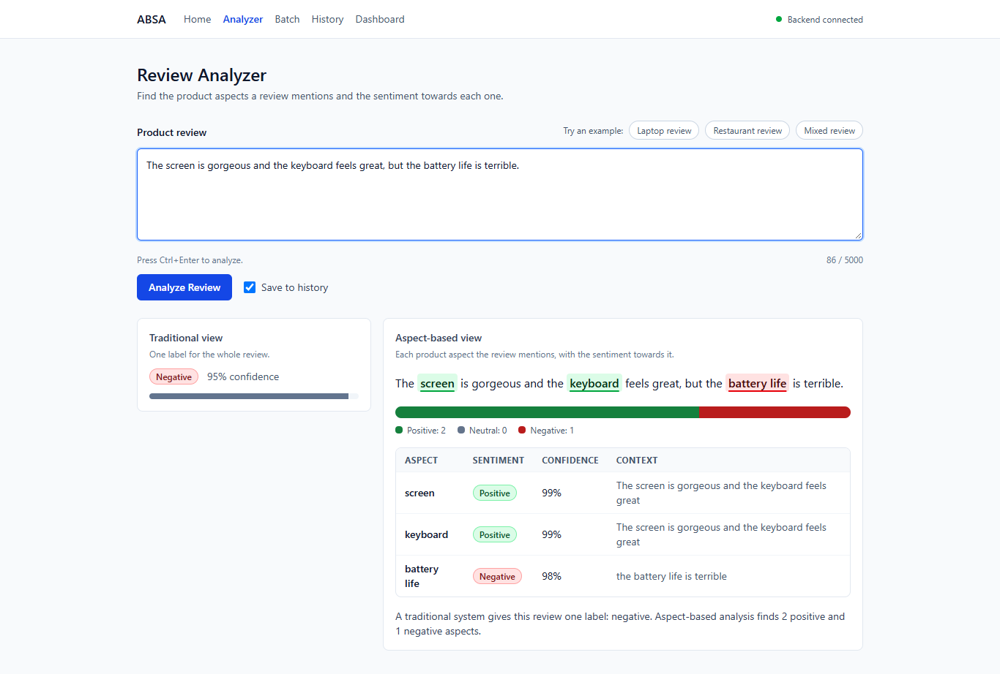
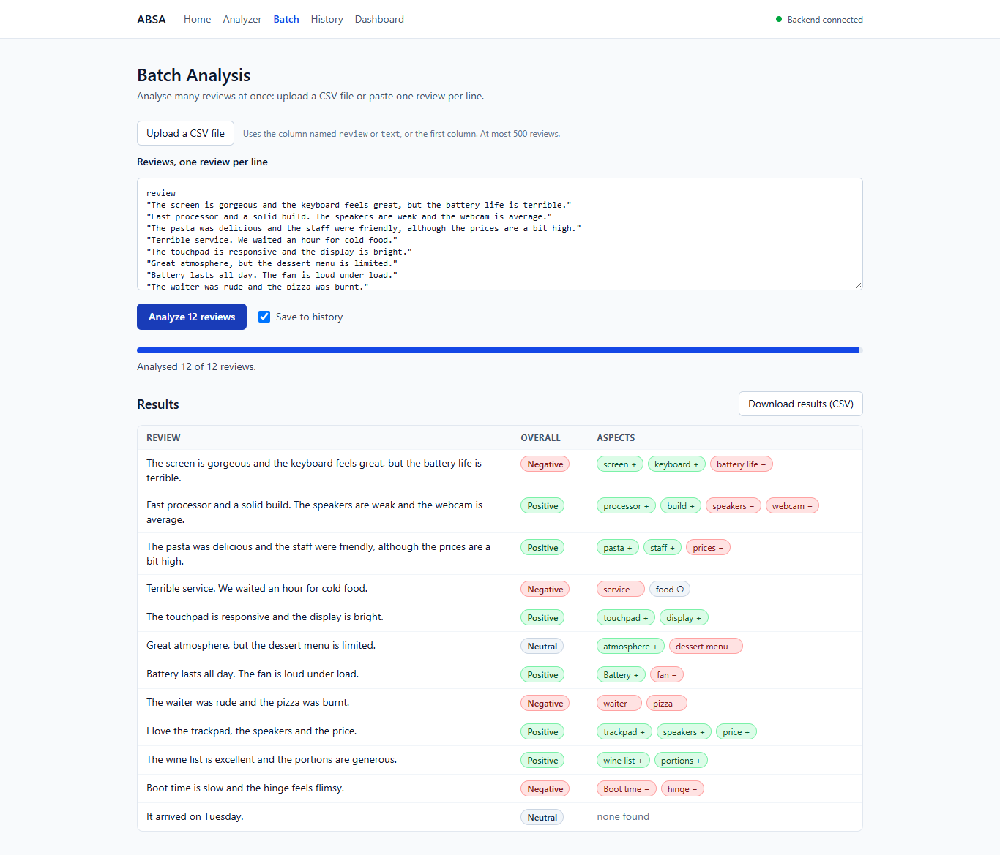
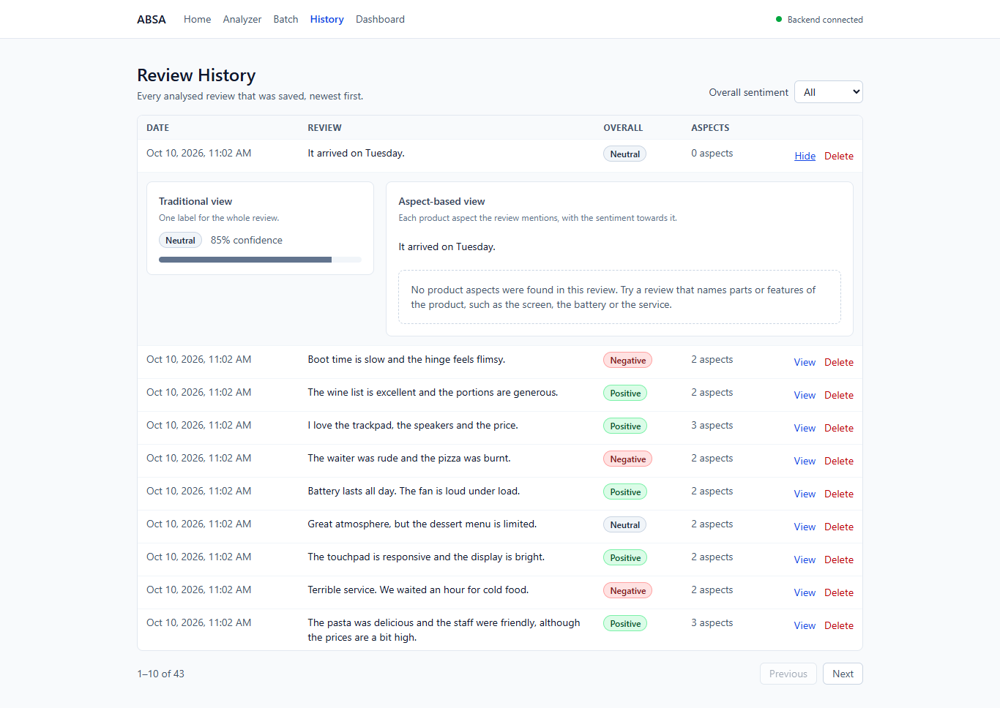
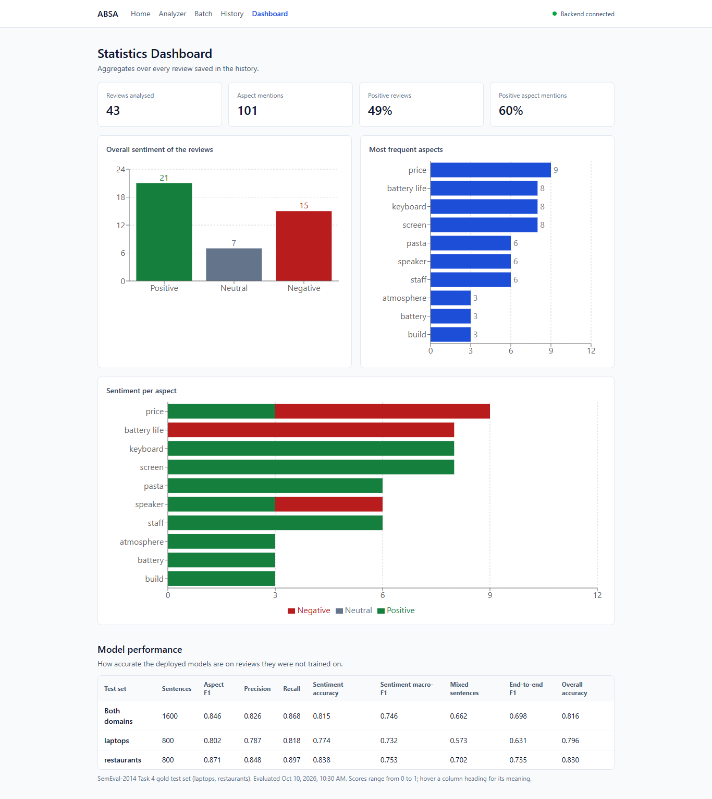
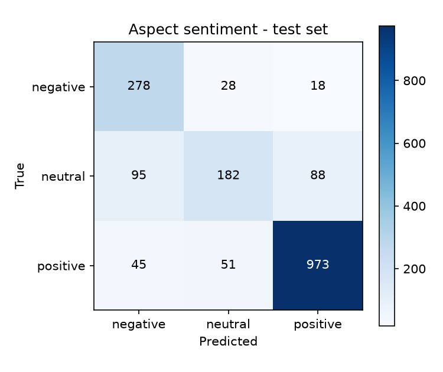

# Aspect-Based Sentiment Analysis for Automated Product Review Analysis Using Natural Language Processing

> Generated by `python -m training.report`. The text is maintained in
> `backend/training/report.py`; every number is read from the evaluation outputs.

Evaluation date: 2026-10-10T05:00:39+00:00. Test data: SemEval-2014 Task 4 gold test set (laptops, restaurants).

## Abstract

Traditional sentiment analysis assigns one label to a whole review, although a review
usually praises some features of a product and criticises others. This project builds
a system that extracts the product aspects mentioned in a review and classifies the
sentiment towards each one. Two fine-tuned BERT models do this: a token classifier
that tags aspect terms and a sentence-pair classifier that judges one aspect at a time.
A third model gives the traditional single label for comparison.
On the SemEval-2014 test sets (laptops, restaurants) the system reaches an aspect-extraction
F1 of 0.8462, an aspect-sentiment accuracy of 0.8151 (macro-F1 0.7456)
and an end-to-end F1 of 0.6977. A rule-and-lexicon baseline scored on the same data reaches an aspect-extraction F1 of 0.3765 and an end-to-end F1 of 0.2530.
The models are served by a REST API with a web interface for single reviews, CSV batches,
a review history and an aggregate dashboard.

## 1. Introduction

Online reviews are a main source of feedback for sellers, but there are too many to read.
Automatic sentiment analysis helps, yet a single positive or negative label answers the
wrong question. The sentence "The screen is gorgeous but the battery life is terrible"
is neither positive nor negative: it is positive about the screen and negative about the
battery. A seller needs exactly that breakdown.

Aspect-based sentiment analysis (ABSA) produces it. The task has two parts:

1. **Aspect term extraction**: find the words that name a feature of the product.
2. **Aspect sentiment classification**: decide the sentiment expressed towards each one.

The objectives of the project were to build both parts with learnt models and no
hard-coded aspect list, to measure them on a standard benchmark, to compare them with a
method that uses no neural model, and to deliver a working application around them.

## 2. Dataset

SemEval-2014 Task 4 (Pontiki et al., 2014): review sentences from two domains, laptops and
restaurants, annotated by people with aspect terms, their character offsets and their
polarity. The official training data was split 90/10 into training and validation; the
official gold test set is used unchanged.

| Domain | Training sentences | Validation sentences | Test sentences | Test aspect terms |
|---|---|---|---|---|
| laptops | 2723 | 303 | 800 | 654 |
| restaurants | 2726 | 303 | 800 | 1134 |

The preparation script validates the annotations and removes training sentences that are
duplicates or that also occur in the test set, so that no sentence is shared between
splits. Aspects annotated as `conflict` (both praised and criticised) are kept for
extraction and left out of sentiment classification, the usual three-class setting.
Details: [methodology.md](methodology.md), section 2.

## 3. Method

All models start from `bert-base-uncased` and are fine-tuned end to end.

**Preprocessing.** Text is cleaned (HTML, Unicode, whitespace), split into sentences and
tokenised into words with character offsets. Stop words are not removed and nothing is
stemmed, because BERT depends on words such as "not" and "but". The same code prepares
text for training and for the running application.

**Aspect extraction.** A token classifier labels every word `B-ASPECT`, `I-ASPECT` or `O`
(BIO scheme), so multi-word aspects such as "battery life" are found as one unit. When
BERT splits a word into several pieces, the first piece carries the label.

**Aspect sentiment.** A sentence-pair classifier receives `[CLS] sentence [SEP] aspect [SEP]`
and outputs positive, negative or neutral. Because the aspect is part of the input, one
sentence can receive different labels for different aspects.

**Overall sentiment.** A third classifier reads the sentence alone. It represents the
traditional approach and is shown next to the aspect-based result. SemEval-2014 has no
sentence-level labels, so it is trained on labels derived from the aspect polarities; its
scores are indicative only.

**Baseline.** To measure what the neural models add, the same tasks are solved without
them: aspects are runs of nouns found by a part-of-speech tagger, and sentiment is a count
of opinion words from the Hu and Liu (2004) lexicon in the aspect's clause, with a simple
negation rule.

## 4. System

```
review -> preprocessing -> aspect extraction -> aspect sentiment + overall sentiment
       -> REST API (FastAPI) -> database (SQLite) -> web interface (React)
```

The backend exposes endpoints to analyse one review or a batch, to list, read and delete
stored reviews, and to return aggregate statistics, service health and the evaluation
report. The web interface has five pages: an introduction, the analyzer (highlighted
aspects, a table with sentiment and confidence, and the overall label), batch analysis of
CSV files with export, the review history, and a dashboard with charts and the models'
test metrics. Architecture: [architecture.md](architecture.md). Endpoints: [API.md](API.md).









## 5. Experimental setup

| | Aspect extraction | Aspect sentiment | Overall sentiment |
|---|---|---|---|
| Training domains | laptops, restaurants | laptops, restaurants | laptops, restaurants |
| Epochs | 3 | 4 | 4 |
| Batch size | 16 | 16 | 16 |
| Learning rate | 3e-05 | 2e-05 | 2e-05 |
| Maximum sequence length | 128 | 128 | 128 |
| Random seed | 42 | 42 | 42 |
| Best epoch on validation | 3 | 3 | 4 |
| Training time (minutes) | 78.62 | 94.96 | 37.33 |
| Device | cpu | cpu | cpu |

Optimiser AdamW with weight decay 0.01, linear warm-up over 10% of the steps followed by
linear decay, gradient clipping at 1.0. After every epoch the model is scored on the
validation split and only the best checkpoint is kept; the test set plays no part in
training. Aspect extraction is scored by exact span match (both boundaries must equal the
annotation). End-to-end scoring starts from raw text and counts an (aspect, sentiment) pair
only if span and sentiment are both right.

## 6. Results

### 6.1 The deployed models

| Metric | Both domains | Laptops | Restaurants |
|---|---|---|---|
| Aspect extraction precision | 0.8255 | 0.7868 | 0.8475 |
| Aspect extraction recall | 0.8680 | 0.8180 | 0.8968 |
| Aspect extraction F1 | 0.8462 | 0.8021 | 0.8715 |
| Aspect sentiment accuracy | 0.8151 | 0.7743 | 0.8384 |
| Aspect sentiment macro-F1 | 0.7456 | 0.7322 | 0.7528 |
| Overall sentiment accuracy | 0.8160 | 0.7956 | 0.8300 |
| Overall sentiment macro-F1 | 0.7202 | 0.7310 | 0.7074 |
| End-to-end F1 | 0.6977 | 0.6308 | 0.7355 |

Per-class results for aspect sentiment (both domains):

| Class | Precision | Recall | F1 | Test aspects |
|---|---|---|---|---|
| negative | 0.6651 | 0.8580 | 0.7493 | 324 |
| neutral | 0.6973 | 0.4986 | 0.5815 | 365 |
| positive | 0.9018 | 0.9102 | 0.9060 | 1069 |



Full tables per domain: [results.md](results.md).

### 6.2 Sentences that mix sentiments

In a sentence whose aspects all share one sentiment, a classifier can be right without
looking at the aspect. Only sentences with differing aspects test whether predictions are
aspect-specific.

| Sentence type | Test aspects | Accuracy | Macro-F1 |
|---|---|---|---|
| uniform | 1427 | 0.8507 | 0.7695 |
| mixed | 331 | 0.6616 | 0.6540 |

### 6.3 Comparison with the rule-and-lexicon baseline

**Both domains**

| Metric | Baseline | BERT (deployed) | Difference |
|---|---|---|---|
| Aspect extraction precision | 0.2736 | 0.8255 | +0.5520 |
| Aspect extraction recall | 0.6035 | 0.8680 | +0.2645 |
| Aspect extraction F1 | 0.3765 | 0.8462 | +0.4698 |
| Aspect sentiment accuracy | 0.6633 | 0.8151 | +0.1519 |
| Aspect sentiment macro-F1 | 0.6159 | 0.7456 | +0.1297 |
| Overall sentiment accuracy | 0.7201 | 0.8160 | +0.0959 |
| Overall sentiment macro-F1 | 0.6475 | 0.7202 | +0.0727 |
| End-to-end F1 | 0.2530 | 0.6977 | +0.4447 |

**Laptops**

| Metric | Baseline | BERT (deployed) | Difference |
|---|---|---|---|
| Aspect extraction precision | 0.1755 | 0.7868 | +0.6112 |
| Aspect extraction recall | 0.4740 | 0.8180 | +0.3440 |
| Aspect extraction F1 | 0.2562 | 0.8021 | +0.5459 |
| Aspect sentiment accuracy | 0.6724 | 0.7743 | +0.1019 |
| Aspect sentiment macro-F1 | 0.6471 | 0.7322 | +0.0850 |
| Overall sentiment accuracy | 0.7032 | 0.7956 | +0.0925 |
| Overall sentiment macro-F1 | 0.6623 | 0.7310 | +0.0687 |
| End-to-end F1 | 0.1590 | 0.6308 | +0.4718 |

**Restaurants**

| Metric | Baseline | BERT (deployed) | Difference |
|---|---|---|---|
| Aspect extraction precision | 0.3531 | 0.8475 | +0.4944 |
| Aspect extraction recall | 0.6781 | 0.8968 | +0.2187 |
| Aspect extraction F1 | 0.4644 | 0.8715 | +0.4071 |
| Aspect sentiment accuracy | 0.6580 | 0.8384 | +0.1804 |
| Aspect sentiment macro-F1 | 0.5939 | 0.7528 | +0.1589 |
| Overall sentiment accuracy | 0.7317 | 0.8300 | +0.0983 |
| Overall sentiment macro-F1 | 0.6301 | 0.7074 | +0.0773 |
| End-to-end F1 | 0.3215 | 0.7355 | +0.4140 |

Details: [baseline.md](baseline.md).

### 6.4 Transfer to an unseen domain

The first aspect-extraction model of the project was trained on laptop reviews only,
with the same settings as the deployed one. Its scores on the restaurant test set measure
transfer to a product category absent from training. Sentiment scores are not compared:
the earlier laptops-only sentiment model has no training record, so a difference could
not be attributed to the training domains.

**Restaurants test set**

| Metric | Trained on laptops only | BERT (deployed) | Difference |
|---|---|---|---|
| Aspect extraction precision | 0.8923 | 0.8475 | -0.0448 |
| Aspect extraction recall | 0.2337 | 0.8968 | +0.6631 |
| Aspect extraction F1 | 0.3704 | 0.8715 | +0.5011 |

**Laptops test set**

| Metric | Trained on laptops only | BERT (deployed) | Difference |
|---|---|---|---|
| Aspect extraction precision | 0.7864 | 0.7868 | +0.0004 |
| Aspect extraction recall | 0.7936 | 0.8180 | +0.0245 |
| Aspect extraction F1 | 0.7900 | 0.8021 | +0.0121 |

Details and examples from other product categories: [transfer.md](transfer.md).

## 7. Error analysis

[error_analysis.md](error_analysis.md) breaks the errors down per domain: aspects missed,
found with wrong boundaries or invented; the aspect terms missed most often; which
sentiments are confused with which; accuracy by reported confidence; and a sample of
misclassified sentences. The per-class table in 6.1 and the mixed-sentence table in 6.2
show where the classifier is weakest.

## 8. Limitations

- The training data is laptop and restaurant reviews from 2014. Other product categories
  work only as far as the models generalise; section 6.4 quantifies one such case.
- Only explicit aspects are found. "It dies after two hours" implies the battery but
  names no aspect.
- The sentiment classifier identifies an aspect by its text. The same term occurring twice
  in one sentence with different sentiments gets one prediction.
- Overall-sentiment labels are derived from aspect labels, not annotated.
- Every number comes from one training run with one random seed; there are no confidence
  intervals. The deployed models were chosen over the earlier ones by comparing test
  scores, which makes the reported scores slightly optimistic.
- Confidence values are softmax probabilities and are not calibrated.
- The Docker setup in the repository has not been run on the development machine.

## 9. Conclusion

The project delivers a complete aspect-based sentiment analysis system: a reproducible data
pipeline, three fine-tuned BERT models, an evaluation that is regenerated by script, a
tested REST API and a web application.
Against a rule-and-lexicon baseline on the same test data, aspect-extraction F1 changes from 0.3765 to 0.8462 and end-to-end F1 from 0.2530 to 0.6977.
Sentiment accuracy is 0.8507 on aspects in uniform sentences and 0.6616 in mixed ones, so sentences that mix sentiments remain the main open problem, together with the neutral class.

Future work: more training data with contrasting aspects, marking the aspect's position
in the classifier input, several training runs to report variance, implicit aspects, and
annotated data from further product categories.

## References

- Devlin, J., Chang, M.-W., Lee, K., Toutanova, K. (2019). BERT: Pre-training of Deep
  Bidirectional Transformers for Language Understanding. *NAACL 2019*.
- Hu, M., Liu, B. (2004). Mining and Summarizing Customer Reviews. *KDD 2004*.
- Pontiki, M., Galanis, D., Pavlopoulos, J., Papageorgiou, H., Androutsopoulos, I.,
  Manandhar, S. (2014). SemEval-2014 Task 4: Aspect Based Sentiment Analysis.
  *Proceedings of SemEval 2014*.
