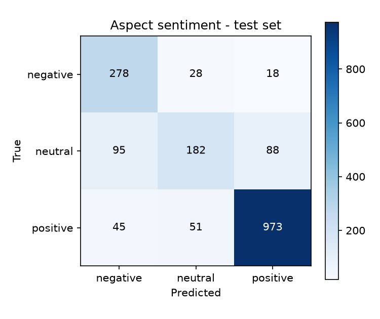
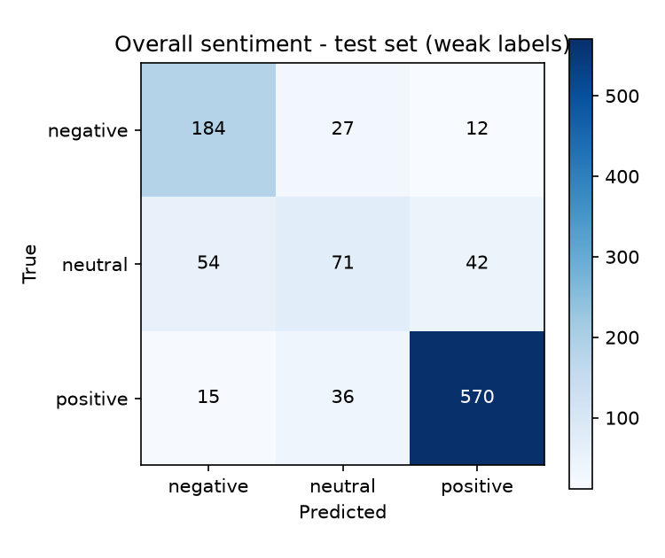

# Evaluation results

> Generated by `python -m training.evaluate`. Do not edit by hand: rerun the
> script after retraining and this file is rewritten from the new predictions.

- Generated: 2026-10-10T05:00:39+00:00
- Test data: SemEval-2014 Task 4 gold test set, domains: laptops, restaurants
- Test sentences: 1600

## Training setup

| | Aspect extraction | Aspect sentiment | Overall sentiment |
|---|---|---|---|
| Base model | bert-base-uncased | bert-base-uncased | bert-base-uncased |
| Training domains | laptops, restaurants | laptops, restaurants | laptops, restaurants |
| Epochs | 3 | 4 | 4 |
| Batch size | 16 | 16 | 16 |
| Learning rate | 3e-05 | 2e-05 | 2e-05 |
| Max sequence length | 128 | 128 | 128 |
| Seed | 42 | 42 | 42 |
| Best epoch (validation) | 3 | 3 | 4 |
| Model-selection metric | f1 | macro_f1 | macro_f1 |
| Best validation score | 0.8312342569269521 | 0.7573510880202651 | 0.7362959598253717 |
| Training time (minutes) | 78.62 | 94.96 | 37.33 |
| Device | cpu | cpu | cpu |
| Training examples | 5449 sentences | 5327 (sentence, aspect) pairs | 3088 sentences |

## All evaluated domains

Test sentences: 1600

### Aspect extraction and end-to-end ABSA

Exact match: a predicted aspect counts only if both of its boundaries equal the
annotation. End-to-end additionally requires the predicted sentiment to be correct.

| Task | Precision | Recall | F1-score |
|---|---|---|---|
| Aspect extraction | 0.8255 | 0.8680 | 0.8462 |
| End-to-end (aspect + sentiment) | 0.6807 | 0.7156 | 0.6977 |

Gold aspects: 1788, predicted: 1880, correct: 1552.

### Aspect sentiment classification (gold aspects given)

Examples: 1758

| Metric | Value |
|---|---|
| Accuracy | 0.8151 |
| Precision (macro) | 0.7547 |
| Recall (macro) | 0.7556 |
| F1-score (macro) | 0.7456 |
| F1-score (weighted) | 0.8097 |

| Class | Precision | Recall | F1-score | Support |
|---|---|---|---|---|
| negative | 0.6651 | 0.8580 | 0.7493 | 324 |
| neutral | 0.6973 | 0.4986 | 0.5815 | 365 |
| positive | 0.9018 | 0.9102 | 0.9060 | 1069 |

Confusion matrix (rows = true class, columns = predicted class):

| true \ predicted | negative | neutral | positive |
|---|---|---|---|
| **negative** | 278 | 28 | 18 |
| **neutral** | 95 | 182 | 88 |
| **positive** | 45 | 51 | 973 |

Accuracy by sentence type. In a *uniform* sentence every aspect has the same
sentiment; in a *mixed* sentence the aspects differ, so the model must be
aspect-specific to be right:

| Sentence type | Aspects | Accuracy | F1-score (macro) |
|---|---|---|---|
| uniform | 1427 | 0.8507 | 0.7695 |
| mixed | 331 | 0.6616 | 0.6540 |

### Overall (sentence-level) sentiment - weak labels

Examples: 1011

| Metric | Value |
|---|---|
| Accuracy | 0.8160 |
| Precision (macro) | 0.7235 |
| Recall (macro) | 0.7227 |
| F1-score (macro) | 0.7202 |
| F1-score (weighted) | 0.8109 |

| Class | Precision | Recall | F1-score | Support |
|---|---|---|---|---|
| negative | 0.7273 | 0.8251 | 0.7731 | 223 |
| neutral | 0.5299 | 0.4251 | 0.4718 | 167 |
| positive | 0.9135 | 0.9179 | 0.9157 | 621 |

Confusion matrix (rows = true class, columns = predicted class):

| true \ predicted | negative | neutral | positive |
|---|---|---|---|
| **negative** | 184 | 27 | 12 |
| **neutral** | 54 | 71 | 42 |
| **positive** | 15 | 36 | 570 |

## Domain: laptops

Test sentences: 800

### Aspect extraction and end-to-end ABSA

Exact match: a predicted aspect counts only if both of its boundaries equal the
annotation. End-to-end additionally requires the predicted sentiment to be correct.

| Task | Precision | Recall | F1-score |
|---|---|---|---|
| Aspect extraction | 0.7868 | 0.8180 | 0.8021 |
| End-to-end (aspect + sentiment) | 0.6193 | 0.6426 | 0.6308 |

Gold aspects: 654, predicted: 680, correct: 535.

### Aspect sentiment classification (gold aspects given)

Examples: 638

| Metric | Value |
|---|---|
| Accuracy | 0.7743 |
| Precision (macro) | 0.7433 |
| Recall (macro) | 0.7627 |
| F1-score (macro) | 0.7322 |
| F1-score (weighted) | 0.7718 |

| Class | Precision | Recall | F1-score | Support |
|---|---|---|---|---|
| negative | 0.5882 | 0.9375 | 0.7229 | 128 |
| neutral | 0.7328 | 0.5030 | 0.5965 | 169 |
| positive | 0.9088 | 0.8475 | 0.8771 | 341 |

Confusion matrix (rows = true class, columns = predicted class):

| true \ predicted | negative | neutral | positive |
|---|---|---|---|
| **negative** | 120 | 5 | 3 |
| **neutral** | 58 | 85 | 26 |
| **positive** | 26 | 26 | 289 |

Accuracy by sentence type. In a *uniform* sentence every aspect has the same
sentiment; in a *mixed* sentence the aspects differ, so the model must be
aspect-specific to be right:

| Sentence type | Aspects | Accuracy | F1-score (macro) |
|---|---|---|---|
| uniform | 535 | 0.8131 | 0.7619 |
| mixed | 103 | 0.5728 | 0.5750 |

### Overall (sentence-level) sentiment - weak labels

Examples: 411

| Metric | Value |
|---|---|
| Accuracy | 0.7956 |
| Precision (macro) | 0.7415 |
| Recall (macro) | 0.7418 |
| F1-score (macro) | 0.7310 |
| F1-score (weighted) | 0.7897 |

| Class | Precision | Recall | F1-score | Support |
|---|---|---|---|---|
| negative | 0.6615 | 0.8776 | 0.7544 | 98 |
| neutral | 0.6452 | 0.4545 | 0.5333 | 88 |
| positive | 0.9178 | 0.8933 | 0.9054 | 225 |

Confusion matrix (rows = true class, columns = predicted class):

| true \ predicted | negative | neutral | positive |
|---|---|---|---|
| **negative** | 86 | 7 | 5 |
| **neutral** | 35 | 40 | 13 |
| **positive** | 9 | 15 | 201 |

## Domain: restaurants

Test sentences: 800

### Aspect extraction and end-to-end ABSA

Exact match: a predicted aspect counts only if both of its boundaries equal the
annotation. End-to-end additionally requires the predicted sentiment to be correct.

| Task | Precision | Recall | F1-score |
|---|---|---|---|
| Aspect extraction | 0.8475 | 0.8968 | 0.8715 |
| End-to-end (aspect + sentiment) | 0.7150 | 0.7571 | 0.7355 |

Gold aspects: 1134, predicted: 1200, correct: 1017.

### Aspect sentiment classification (gold aspects given)

Examples: 1120

| Metric | Value |
|---|---|
| Accuracy | 0.8384 |
| Precision (macro) | 0.7687 |
| Recall (macro) | 0.7469 |
| F1-score (macro) | 0.7528 |
| F1-score (weighted) | 0.8316 |

| Class | Precision | Recall | F1-score | Support |
|---|---|---|---|---|
| negative | 0.7383 | 0.8061 | 0.7707 | 196 |
| neutral | 0.6690 | 0.4949 | 0.5689 | 196 |
| positive | 0.8988 | 0.9396 | 0.9187 | 728 |

Confusion matrix (rows = true class, columns = predicted class):

| true \ predicted | negative | neutral | positive |
|---|---|---|---|
| **negative** | 158 | 23 | 15 |
| **neutral** | 37 | 97 | 62 |
| **positive** | 19 | 25 | 684 |

Accuracy by sentence type. In a *uniform* sentence every aspect has the same
sentiment; in a *mixed* sentence the aspects differ, so the model must be
aspect-specific to be right:

| Sentence type | Aspects | Accuracy | F1-score (macro) |
|---|---|---|---|
| uniform | 892 | 0.8733 | 0.7727 |
| mixed | 228 | 0.7018 | 0.6870 |

### Overall (sentence-level) sentiment - weak labels

Examples: 600

| Metric | Value |
|---|---|
| Accuracy | 0.8300 |
| Precision (macro) | 0.7128 |
| Recall (macro) | 0.7027 |
| F1-score (macro) | 0.7074 |
| F1-score (weighted) | 0.8268 |

| Class | Precision | Recall | F1-score | Support |
|---|---|---|---|---|
| negative | 0.7967 | 0.7840 | 0.7903 | 125 |
| neutral | 0.4306 | 0.3924 | 0.4106 | 79 |
| positive | 0.9111 | 0.9318 | 0.9213 | 396 |

Confusion matrix (rows = true class, columns = predicted class):

| true \ predicted | negative | neutral | positive |
|---|---|---|---|
| **negative** | 98 | 20 | 7 |
| **neutral** | 19 | 31 | 29 |
| **positive** | 6 | 21 | 369 |

## Notes for interpreting these numbers

- 'conflict' aspects are excluded from sentiment evaluation (3-class setting).
- Overall-sentiment labels are not human annotations: they are derived from the
  aspect polarities of each sentence (majority of positive vs. negative, neutral
  on a tie). Treat that table as indicative only.
- All numbers come from a single training run (one seed).
- Models trained by `training.run_all` are selected over the previously deployed models by comparing test-set scores
  (`training.promote`: span F1 for aspect extraction, macro-F1 for sentiment).
  Choosing between two models on the test set makes these numbers slightly
  optimistic as an estimate for unseen reviews.
